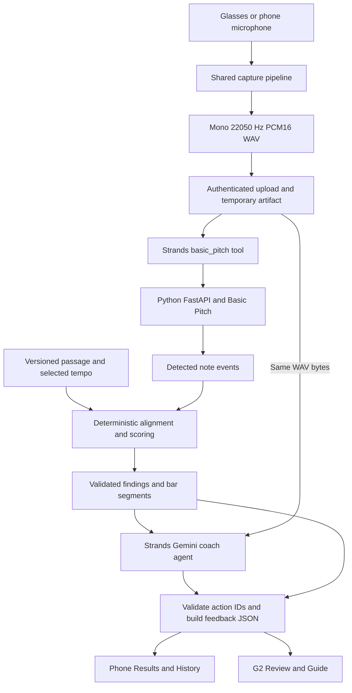

# Encore

We built Encore to help beginner pianists understand what to practice after playing a short passage. It runs on Even Realities G2 glasses with a phone companion, so a player can record a take, review the affected notes, and get one concrete instruction before trying again.

The player chooses a passage and tempo, then records through the glasses microphone or the phone. After recording stops, we compare the detected notes with the written reference and show supported wrong notes, missed notes, extra notes, early or late entrances, and notes held for too long or too little time. On the glasses, Review shows the mistake in its bar and Guide shows the correction. The phone keeps the full findings and saved attempt history.

## Sponsors and tools we use

| Integration | How we use it in Encore | Implementation |
| --- | --- | --- |
| **Even Realities: Even G2 and [Even Hub SDK](https://hub.evenrealities.com/docs/getting-started/installation)** | We use the SDK bridge for glasses microphone events, display containers, and tap/swipe input. The G2 host shares the phone session and processing pipeline, then renders compact review and guidance screens on the glasses. | [G2 host](g2/src/main.ts), [capture driver](g2/src/g2capture.ts), [display transport](g2/src/glasses.ts) |
| **Google: [Gemini](https://ai.google.dev/gemini-api/docs/audio)** | Our coach agent receives the same normalized WAV used for analysis plus measured findings. Gemini chooses one permitted practice action for the highest-priority supported issue. The current configured model is Gemini 3.5 Flash-Lite. | [Coach agent](server/src/coaching.ts), [provider configuration](server/src/provider-config.ts) |
| **AWS: [Strands Agents SDK for TypeScript](https://github.com/strands-agents/sdk-typescript)** | We wrap analysis in a directly invoked basic_pitch tool and use a Strands Agent with its GoogleModel adapter for coaching. The analysis tool runs without language-model inference; the coach makes the Gemini call. | [Analysis workflow](server/src/workflow.ts), [Strands/Gemini adapter](server/src/coaching.ts) |
| **Sentry: Error Monitoring and Tracing** | We implemented opt-in phone error reporting and named spans for capture processing, upload, analysis, coaching, and local persistence. Events use fixed stage/error codes and exclude audio, prompts, coach text, credentials, and request bodies. This is phone instrumentation; backend distributed tracing is not implemented. | [Telemetry](mobile/src/telemetry.ts), [configuration and verification](mobile/docs/sentry.md) |
| **Spotify: [Basic Pitch](https://github.com/spotify/basic-pitch)** | We run Spotify's open-source transcription model locally to extract candidate MIDI pitches, onset times, durations, and detector scores from the recorded WAV. We use the Python library and bundled model, rather than Spotify's streaming Web API. | [Python inference service](analysis/service.py) |

Our supporting stack is TypeScript and Vite for the phone/G2 web app, Node.js for the authenticated API, Python/FastAPI for analysis, IndexedDB for phone-local history, and an existing Tailscale HTTPS route for the glasses backend. Strands runs locally with Gemini as its model provider; this deployment does not use Amazon Bedrock or host inference on AWS.

## How a recording becomes feedback

We use two model stages: Basic Pitch for note transcription and Gemini for coaching. Our own code handles reference alignment, error calculations, bar locations, validation, storage, and graphics.



### 1. Capture and normalize

The G2 capture driver feeds the same session store and submission pipeline used by phone recording. We keep one attempt ID for the take instead of creating separate phone and glasses recordings. Takes are bounded to 30 seconds.

We decode the audio, average channels to mono, resample to **22,050 Hz**, and encode **16-bit little-endian PCM WAV**. Downsampling uses a low-pass filter. The metadata records the original sample rate, normalized format, passage/version, selected tempo, duration, and capture source. The normalization code lives in [mobile/src/audio-normalization.ts](mobile/src/audio-normalization.ts).

### 2. Upload one audio artifact

The client sends WAV bytes and metadata to **POST /api/recordings**. The backend validates the actual WAV header and duration, calculates a SHA-256 digest, and returns an artifact ID. Repeating the same upload for the same attempt returns the same artifact; conflicting data for that attempt is rejected.

Analysis and coaching both refer to this artifact, so they consume the same recording. The backend caches in-flight/completed results to avoid duplicate processing. Uploaded audio has a ten-minute hard expiry and a shorter cleanup/retry window after processing; it is not a permanent recording library. See [recordings.ts](server/src/recordings.ts).

### 3. Transcribe with Spotify Basic Pitch

**POST /api/analyze** retrieves the artifact and directly invokes the Strands basic_pitch tool. That tool calls the Python service at **POST /v1/analyze** with the WAV and metadata. The service loads the bundled Basic Pitch TFLite model once at startup.

Each detected event contains an ID, midiPitch, onsetSec, durationSec, and detectorScore. These are candidate musical events. A detector score is not a calibrated probability, and a transcribed event is not automatically a confirmed mistake.

Before making musical claims, we check the WAV format, audible signal, severe clipping, missing capture chunks, piano pitch range, and alignment evidence. Silence or unreliable alignment produces an insufficient/uncertain result instead of invented corrections.

### 4. Calculate the differences from the reference

Each passage in [shared/passages.json](shared/passages.json) has authored note IDs, MIDI pitches, zero-based onset beats, and durations in beats. The selected tempo converts that reference into seconds. The calculations live in [analysis/scoring.py](analysis/scoring.py), currently scoring version **1.4.0-demo**.

We use monotonic dynamic-programming alignment to pair reference and detected notes in sequence while allowing missing and extra events. In the ordinary alignment, a candidate pair must be within 0.55 matching beats; its cost combines a pitch mismatch cost with 0.7 times its absolute onset residual in beats. Skipping a reference or detected event costs 1.0. We compare candidate offsets and require enough consistent evidence before accepting a correspondence.

After establishing note identity, we anchor the comparison to the first reliably paired played note and its reference beat. This ignores waiting before the entrance while preserving missed opening notes and later rhythmic drift. When a recognizable phrase is played at another speed, we may adapt correspondence to identify notes, but we still calculate timing differences against the **selected tempo**.

For a reliable, correct-pitch pair, the calculations are:

```text
secondsPerBeat = 60 / selectedTempoBpm
expectedOnsetSec = reference.onsetBeat * secondsPerBeat + entranceOffsetSec
expectedDurationSec = reference.durationBeats * secondsPerBeat

timingDeltaMs = (detected.onsetSec - expectedOnsetSec) * 1000
durationDeltaMs = (detected.durationSec - expectedDurationSec) * 1000
```

| Finding | Calculation or rule |
| --- | --- |
| Wrong note | A paired detected MIDI pitch differs from the reference pitch. We do not also grade timing/duration for that wrong-pitch pair. |
| Missing note | An authored reference note has no paired detection. |
| Extra note | A detected event has no reference pair and passes the extra-note evidence checks. Weak unmatched events below detector score 0.35 do not become extra-note findings. |
| Early/late note | A correct-pitch pair has absolute timing difference greater than **150 ms**. Negative means early; positive means late. |
| Too short/long | A correct-pitch pair has detector score at least **0.5**, and its duration difference exceeds **both 200 ms and 25% of the expected duration**. Negative means short; positive means long. |

For example, at 60 BPM, a quarter-note F4 at onset beat 2 should start at 2.70 seconds if the entrance offset is 0.70 seconds, and last 1 second. If a confidently detected F4 starts at 2.95 seconds and lasts 0.55 seconds, the differences are **250 ms late** and **450 ms too short**. If the paired pitch is E4 instead, we report the pitch mismatch rather than treating that event as a correctly played F4 with rhythm errors.

When pitch anchors are insufficient, a guarded fallback can use strong rhythmic attacks to identify wrong/missing notes. In that mode we withhold timing, duration, and unmatched-extra claims. Ambiguous repeated-note boundaries can still suppress the musical findings entirely. These thresholds are demo settings awaiting calibration with labeled acoustic recordings; event duration does not establish physical key release or pedal sustain.

### 5. Locate and prioritize the findings

The TypeScript API validates the Python response and adds deterministic bar/beat locations and one-bar display segments using the passage's beats-per-bar. Reference notes, detected notes, findings, and segments remain tied together by IDs. Gemini does not calculate the location or choose arbitrary ranges. See [segments.ts](shared/segments.ts).

We retain every supported finding for the phone and History. The glasses show at most **ten distinct mistakes**, ordered by missing notes, extra notes, wrong pitch, onset timing, and duration. Timing/duration findings use absolute deviation to rank larger errors first. The compact visual plan contains up to three cards. Matched-note count means pitch-correct aligned notes; median absolute timing error uses eligible correct-pitch pairs, not the whole recording.

### 6. Ask the coach agent for one useful action

**POST /api/coach** validates the request against the backend's stored analysis and retrieves the original WAV. Our Strands Agent calls Gemini with the audio attached as inline WAV bytes, structured evidence for prioritized findings, and a constrained output schema. A URL mentioned in the prompt is not our audio transport.

The server fixes the highest-priority supported finding. Gemini selects a permitted action and matching component for that issue, returning only:

```json
{
  "findingId": "f1",
  "actionId": "count_beats",
  "componentKind": "timing"
}
```

This example is valid only when f1 is the selected timing finding and count_beats is one of its allowed actions. We validate all three IDs, then construct the actual cue, summary, visual references, and primary segment in code. A result can say where the issue happened, what was measured, and what to try next without letting the model invent a new error or measurement.

The agent has a 12-second timeout and makes at most one provider call per coaching operation. Invalid output or ordinary provider failures use labeled deterministic fallback feedback. Quota exhaustion stops further provider calls for that backend process rather than silently switching models or keys. See [coaching.ts](server/src/coaching.ts) and [quota.ts](server/src/quota.ts).

### 7. Render the result on the phone and glasses

The phone shows the full results and keeps structured attempts in IndexedDB. The G2 host reads the same selected finding/bar and renders the glasses screens through the Even Hub bridge. Phone code does not directly write to the glasses.

We draw staff views, keyboard highlights, timing rulers, and duration bars deterministically from validated JSON. Wrong-note Xs stay on the affected written notehead. Extra-note Xs use a separate labeled lane without generating ledger lines at stray detected pitches. Correct context notes remain unmarked, and Guide removes Xs to show the written correction. There is no separate model generating the visualizations.

## Repository map

| Directory | Responsibility |
| --- | --- |
| [g2/](g2/) | Even Hub host, glasses capture/gestures, display transport, Review and Guide |
| [mobile/](mobile/) | Shared phone UI, session state, normalization/submission, retry and local History |
| [analysis/](analysis/) | Python Basic Pitch inference, audio-quality checks, reference alignment and scoring |
| [server/](server/) | Authenticated artifact API, Strands orchestration, Gemini coaching and validation |
| [shared/](shared/) | Passage library, TypeScript contracts, visual JSON schema, segment calculation and finding priority |
| [acceptance/](acceptance/) | Pipeline, storage, contract, and rendering acceptance checks |

## Run and package

Our tested development environment uses **WSL, Node.js 22.14+ and Python 3.10**. Follow [analysis setup](analysis/README.md), [server setup](server/README.md), and [phone setup](mobile/README.md) for dependency and configuration steps. Keep real credential files local and out of Git; provider keys belong only in the backend.

With dependencies prepared, run the combined laptop stack without Gemini calls:

```bash
bash scripts/start-laptop.sh --fallback
```

That starts the G2/phone host on **5173**, the backend on **8788**, and Basic Pitch on **8002**. Use the Even Hub simulator from g2/ with npm run simulate. Real hardware also needs the Even companion app, paired glasses, and a reachable approved host.

To use Gemini locally, configure the ignored server/.env from [server/.env.example](server/.env.example), following its provider/project checks, then run bash scripts/start-laptop.sh without --fallback. Configure Sentry separately as described in [mobile/docs/sentry.md](mobile/docs/sentry.md); it is opt-in and is not automatically active in every build.

The existing glasses service setup uses **HTTPS 443 -> proxy 5198 -> authenticated backend 8799 -> Basic Pitch 8012**. On the configured WSL machine, python3 scripts/device-services.py start starts or reuses the supervisor; python3 scripts/device-services.py status reports its processes. That launcher expects the machine's existing token file and prepared build. It survives shell exit but must be started again after Windows/WSL shutdown.

Build package version **0.1.4** for the approved exact HTTPS origin:

```bash
cd g2
npm run pack -- https://timothylggram.tail51e140.ts.net
```

The packaging script validates the exact network whitelist, builds the app, and writes an EHPK plus build/checksum metadata. The session token is entered in the host UI and held in memory, so a reload may require entering it again. It is not bundled into the package. See [G2 integration contract](glasses-integration/CONTRACT.md) and [0.1.4 handoff](docs/glasses-score-cleanup.md).

## Verification and current limits

```bash
bash scripts/verify-storage.sh --include-g2
node acceptance/glasses-note-markers.browser.mjs
```

The current implementation passed **430 automated checks** across server, phone, glasses, Python scoring, contracts, and storage/shipping acceptance, plus production builds and typechecks. Rendering checks covered **18 targeted frames** and **122 gallery frames**. An authorized synthetic WAV test also passed through public HTTPS upload, real Basic Pitch analysis, and a live Gemini coaching response. These establish automated/rendering/API behavior; they do not establish physical glasses capture or acoustic accuracy.

The current flow targets short, authored piano passages. We do not infer posture, hand tension, velocity, pedal use, or fingering from microphone pitch data, and we do not promise arbitrary song transcription or automatic sheet-music import. History is local to the phone/WebView, without account-based cross-device sync. See [storage policy](docs/storage-verification.md), [physical-device verification](docs/physical-device-verification.md), and the [engineering specification](spec.md) for details.
